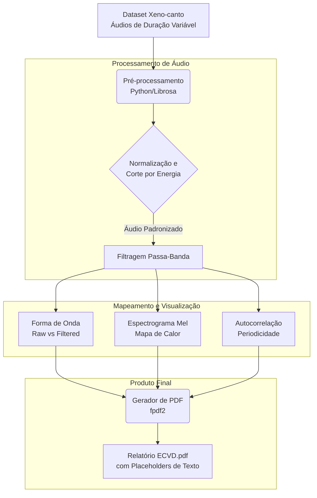

# song_view
# ECVD: Análise Exploratória de Dados de Bioacústica

Este documento descreve o fluxo de trabalho para o Estudo de Caso de Visualização de Dados (ECVD) focado no processamento e análise visual de vocalizações de pássaros.

## 1. Escopo e Desafio
O objetivo é processar áudios de duração variável (contendo cantos de aves e ruído ambiente) e extrair representações visuais acessíveis e compreensíveis. O desafio técnico reside na limpeza do sinal (filtragem) e na demonstração visual da periodicidade das vocalizações, facilitando a criação de um dataset higienizado para modelos de IA.

## 2. Fluxo de Processamento (Pipeline)

Abaixo apresentamos o diagrama de blocos do processo, desde a entrada do áudio bruto até a geração do relatório em PDF.

